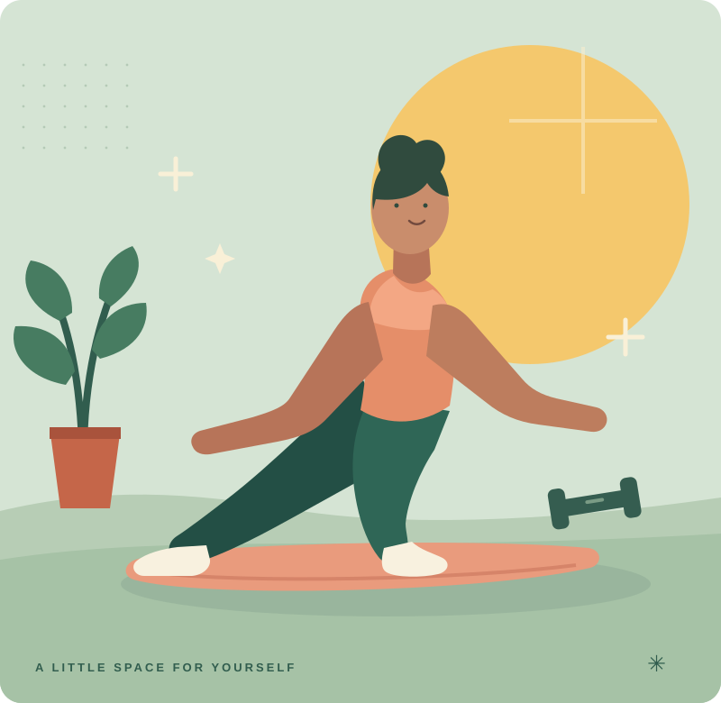

# Everyday Strong 🌿💪



[](https://github.com/dmoliveira/everyday-strong/actions/workflows/pages.yml)
[](https://dmoliveira.github.io/everyday-strong/)
[](https://dmoliveira.github.io/everyday-strong/#plan)
[](https://dmoliveira.github.io/everyday-strong/#progress)
[](https://buy.stripe.com/8x200i8bSgVe3Vl3g8bfO00)

### A little stronger, a little more confident, one week at a time. ✳️

**[Open Everyday Strong →](https://dmoliveira.github.io/everyday-strong/)**

A free, mobile-friendly home fitness plan and private workout tracker for real life. Explore strength, cardio and mobility at your own pace. No account, subscription or gym required.

## Start here 🚀

1. [Open the plan](https://dmoliveira.github.io/everyday-strong/#plan) and choose any week from 1 to 52.
2. Explore workouts A, B and C; open a movement for its instructions, easier option and optional set log.
3. Tick movements as you complete them. Log cycling or walking separately if you like.
4. Set an optional start date or move a session. Leave recovery time between challenging strength days.
5. [Download a JSON backup](https://dmoliveira.github.io/everyday-strong/#progress) regularly if you want to keep your progress or move it to another device.

Open **Personalise your plan** to choose your usual strength days and set goal. The suggested first two weeks and easier/review weeks remain capped at two sets; choosing a goal does not change past set logs. Use the rest timer between sets if useful. In a movement's details, quick-fill an alternative or enter your own and mark it as an alternative; the original movement's rep target may not apply. These choices are guidance, not personalised medical advice.

## What's inside 🧰

- **Four 13-week phases**: Foundation, Build, Develop and Consolidate. The original plan contains 72 programmed slots, including deliberate repeated movements—not 72 unique exercises.
- **Three full-body strength sessions** each week, including direct abdominal work; exercise names in English and Brazilian Portuguese.
- **Cardio and mobility**, flexible weekly targets, a lighter week every fourth week and gentle phase-end reviews.
- **Private tracking**: movement completion, individual sets, variation, resistance, repetitions in reserve, discomfort, notes, cardio and dates. Checkboxes mark movements, not individual sets.
- **Personalise your rhythm**: choose usual strength days, a set goal and rest duration, log an alternative movement and jump between key sections on mobile. The timer is visual only, does not send notifications and resets if the page reloads.
- **Thoughtful suggestions** based on comparable completed sets; they are optional heuristics, never a diagnosis or a requirement to progress.
- **Portable data**: complete JSON backup/restore and a readable CSV export. Progress stays in this browser, on this device. There is no sign-in, analytics service or cloud sync.

Built around bodyweight, bands, optional light dumbbells, a bike and a treadmill; adjustments are welcome. Strength sessions can be moved, repeated or skipped. A lower-pressure week still counts. 🌱

## A note on safety 🫶

This is general fitness information, **not an individual medical assessment or a clinical exercise prescription**. No site can determine whether a workout is medically suitable for you. If you have an injury, health concern or have been inactive for a long time, consult a GP or accredited exercise professional before starting. Stop for sharp or persistent pain, chest pain, faintness or unusual breathlessness and seek appropriate medical help. Read the [full safety notes](https://dmoliveira.github.io/everyday-strong/#safety).

## Privacy & backups 🔒

- Your progress lives in `localStorage` for this site's browser origin. It does not automatically sync to other browsers or devices. Clearing site data, private browsing or storage restrictions can remove it.
- The app warns if browser storage is unavailable. Download your JSON backup before leaving if progress is temporary. Restoring a backup replaces current data after confirmation; CSV is not a restorable backup.
- Existing v2 data and backups remain readable. Preferences and alternative flags are included in new backups. Changing usual days preserves the dates of logged strength sessions—including an unknown date—and moves only the default dates of unrecorded sessions; individual dates can still be changed. Setting a different start date continues to adjust dates that haven't been explicitly set or preserved.
- The old prototype's `homefit52_v1` data is automatically imported **only if it exists on the same browser origin** and no newer data exists. Original exercise ticks map using the frozen phase/day/order template; they are not converted into set logs. Old weekly check-ins and the raw legacy object are preserved in the JSON backup. A raw legacy JSON object can also be restored through the backup control. A file opened as `file://` or on another host has separate browser storage and cannot be read automatically.
- Optional Stripe and YouTube links open third-party sites only when selected. Stripe support is optional, uses the same creator support link as Master Philosophers, and does not unlock or gate content.

## Development 🛠️

The site is plain HTML, CSS and JavaScript. A local HTTP server is needed for JavaScript modules:

```sh
npm ci
python3 -m http.server 8000
# Open http://localhost:8000/
```

Run the programme and persistence tests with `npm test`. To run the responsive browser tests, install Playwright's Chromium with `npx playwright install chromium`, then run `npm run test:browser`. GitHub Actions tests the site and deploys a minimal static artifact to Pages on `main`.

### Content and progression logic

`src/plan-data.js` freezes the supplied four-phase exercise sequences and bilingual names. Exercise IDs derive from the original English names and do not depend on a slot's array position. `src/plan.js` owns week boundaries, dates, recovery rules and guidance; `src/state.js` validates backups and handles legacy migration. A session is counted complete when all six movement ticks are checked; individual set entries are separate. A progression suggestion requires two non-easy weeks of the same prescribed movement and dose, all recorded sets at the top of the original range, at least the original and current set minimums, RIR 2–10, no discomfort, a matching recorded variation and matching recorded weight/band fields (which may be blank), and completed movement ticks. Movements marked as alternatives and ambiguous mixed-unit prescriptions do not trigger a suggestion.

## Support the project 💛

If this is useful, you can optionally [support via Stripe](https://buy.stripe.com/8x200i8bSgVe3Vl3g8bfO00). The same link supports the creator's free learning projects, including [Master Philosophers](https://github.com/dmoliveira/master-philosophers). The full workout plan remains free.

### Sources 📚

- [Australian 24-hour movement guidelines for adults](https://www.health.gov.au/topics/physical-activity/24-hour-movement-guidelines-for-all-australians/recommendations-for-adults-18-to-64-years)
- [ACSM resistance-training guidance](https://pubmed.ncbi.nlm.nih.gov/41843416/)
